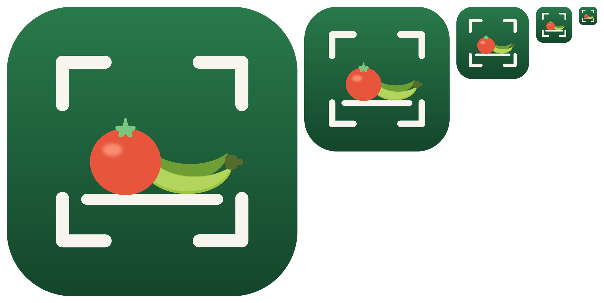
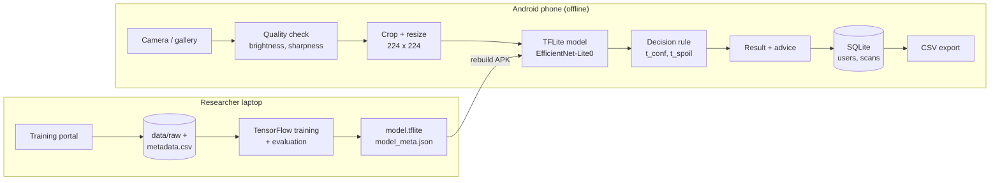
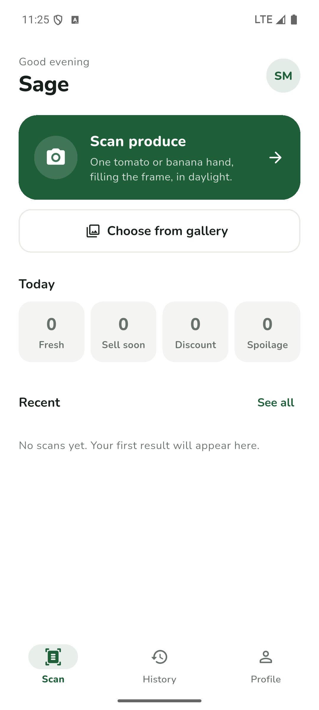
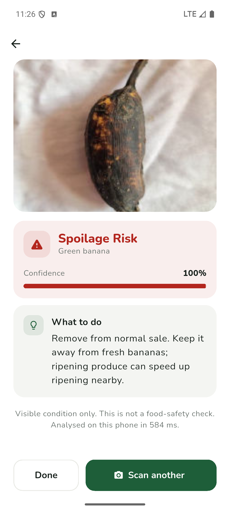
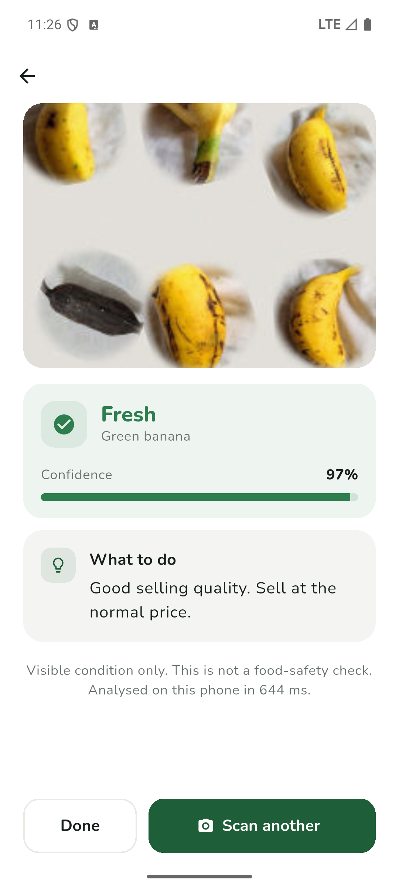
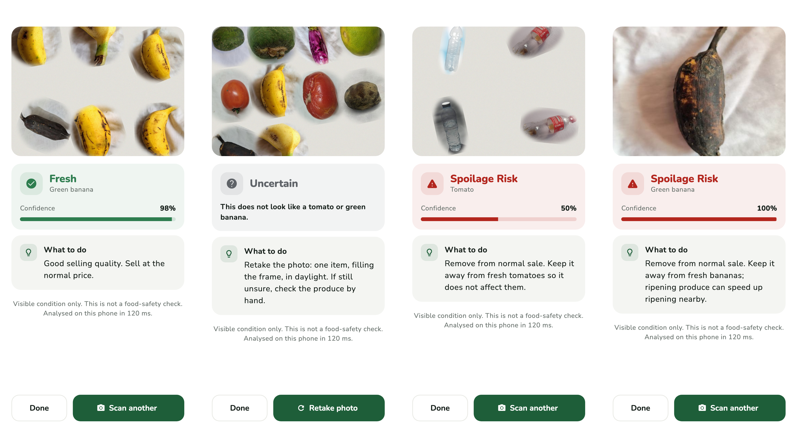

# HarvestShelf AI



**An offline Android app that tells small market sellers what to do with their produce, from one phone photo.**

| | |
|---|---|
| **GitHub repository** | [github.com/Muhodari/HarvestShelfAI](https://github.com/Muhodari/HarvestShelfAI) |
| **Demo video** | [youtu.be/yV0wDrwIIkw](https://youtu.be/yV0wDrwIIkw) |
| **Project notebook** | [`training/notebooks/HarvestShelf_AI.ipynb`](training/notebooks/HarvestShelf_AI.ipynb) |

---

## Contents

1. [Description](#1-description)
2. [GitHub repository](#2-github-repository)
3. [Setting up the environment and the project](#3-setting-up-the-environment-and-the-project)
4. [Designs](#4-designs)
5. [Deployment plan](#5-deployment-plan)
6. [Technical details](#6-technical-details)

---

## 1. Description

Small produce sellers in Rwanda lose income when tomatoes and green bananas spoil before they are sold. HarvestShelf AI lets a seller point a phone camera at one tomato or one hand of green bananas and get one clear action back:

| Action | Meaning for the seller |
|---|---|
| **Fresh** | Sell at the normal price |
| **Sell Soon** | Early signs of change: put it at the front and sell it first |
| **Discount Today** | Lower the price and sell it today |
| **Spoilage Risk** | Remove from sale; keep it away from fresh produce |
| **Uncertain** | Photo too dark or blurry, model unsure, or not a supported crop: retake the photo |

Built for sellers in **Nyabihu and Rusizi, Rwanda**. BSc Software Engineering project by **Sage Muhodari**.

| | |
|---|---|
| **Crops** | Tomato and green banana only |
| **Platform** | Android phone, Flutter app |
| **Internet** | Not needed: the model runs on the phone, and the release build has no INTERNET permission |
| **Languages** | English and Kinyarwanda |
| **Model** | EfficientNet-Lite0, TensorFlow Lite, 3.7 MB |
| **Accounts** | Stored on the phone only, with PIN login (Researcher and Seller roles) |
| **Training** | Python / TensorFlow pipeline, with a browser portal for uploading photos and retraining |

> **Important: only tomatoes and green bananas are supported.** Photos of anything else (oranges, potatoes, onions, …) are answered with **Uncertain**, never with a freshness result.

> **Warning:** the app judges **visible condition only**. It is **not a food-safety check**.

## 2. GitHub repository

**[https://github.com/Muhodari/HarvestShelfAI](https://github.com/Muhodari/HarvestShelfAI)**

```bash
git clone https://github.com/Muhodari/HarvestShelfAI.git
cd HarvestShelfAI
```

### Repository layout

```
app/          Flutter Android app (offline)
training/     Python/TensorFlow pipeline: clean → split → train → thresholds → evaluate → export
  portal/     browser portal to upload photos and train
  notebooks/  the project notebook
shared/       decision rule and quality-check cases, tested in both Dart and Python
data/         field photos + metadata.csv (not committed)
scripts/      copy_model_to_app.sh, build_release.sh, make_logo.py
```

## 3. Setting up the environment and the project

### Requirements

| Part | Setup | Check |
|---|---|---|
| **App** | Flutter **3.32.5** (pinned in `.fvmrc`), Android SDK 36, NDK 27 | `cd app && flutter analyze && flutter test` |
| **Training** | Python **3.11**: `cd training && python3.11 -m venv .venv && .venv/bin/pip install -r requirements.txt` | `make test PY=.venv/bin/python` |
| **Training in Docker** | `docker build -t harvestshelf-train:2.15 training/`, then `docker run --rm -it -v "$PWD":/workspace -w /workspace/training harvestshelf-train:2.15` | `python -m pytest -q tests` |
| **Public dataset** | `cd training && make data-public` downloads AgriFreshNET (348 MB, CC BY 4.0) | |
| **Notebook kernel** | `.venv/bin/python -m ipykernel install --sys-prefix --name harvestshelf` | open the notebook |
| **CI** | `.github/workflows/ci.yml` runs the app tests, the Python tests and a smoke test on every push | |

### Run the app

```bash
cd app
flutter test                                                   # unit, widget and full-app-flow tests
flutter test integration_test/parity_test.dart -d <device>     # phone vs Python on real test photos
flutter run                                                    # on a connected Android phone
../scripts/build_release.sh                                    # release APKs; fails if extra permissions sneak in
```

### Retrain from the command line

```bash
cd training
make public PY=.venv/bin/python     # public data → train all candidates → install the best in the app
```

### Training portal (optional)

```bash
cd training && .venv/bin/python -m portal      # then open http://127.0.0.1:8765
```

See [Training portal](#training-portal-add-photos-and-retrain) below for what each tab does.

## 4. Designs

### Figma mockups

<!-- TODO: replace with the Figma link and an exported image of the mockups -->
**Figma file:** *link to be added*

### Circuit diagram

HarvestShelf AI is **software only**: it runs on an ordinary Android phone and uses no extra hardware, sensors or circuits, so there is no circuit diagram. The system architecture is shown instead:



### Screenshots of the app

| Scan tab | Spoilage Risk result | Fresh result |
|:-:|:-:|:-:|
|  |  |  |

All five result types share the same layout: the photo, the action with its confidence, and what to do next. A photo that is not a tomato or a green banana is answered with **Uncertain**:



## 5. Deployment plan

The app is deployed **directly onto phones as an APK**, not through the Play Store, because it is a research tool used in a supervised field study and needs no internet.

| Step | What happens | Tool |
|---|---|---|
| **1. Test** | Every push runs the app tests, the Python tests and a training smoke test. | GitHub Actions ([`.github/workflows/ci.yml`](.github/workflows/ci.yml)) |
| **2. Train the model** | Collect labelled market photos with the training portal, retrain, and check the results against the targets (macro-F1 ≥ 0.80, spoilage recall ≥ 0.85, model < 10 MB). | `training/` pipeline, training portal |
| **3. Install the model** | Copy the exported model and its thresholds into the app. No app code changes are needed. | **Install in app** in the portal, or `scripts/copy_model_to_app.sh` |
| **4. Build the release** | Build one APK per CPU type (each under 50 MB). The build fails if the app asks for internet, phone or storage permissions. | `scripts/build_release.sh` |
| **5. Install on phones** | Copy the APK to each study phone (USB or `adb install`) and install it. The first account created on a phone is the Researcher. | `adb install app-arm64-v8a-release.apk` |
| **6. Field study** | Sellers in Nyabihu and Rusizi markets use the app. Everything stays on the phone. | the app |
| **7. Collect results** | The researcher exports the scan log as CSV (anonymous user IDs, inference time per scan) and compares it with the targets. | Profile → Export |
| **8. Update** | New field photos go back into the portal, the model is retrained, and a new APK is installed over the old one. Existing scans and accounts are kept. | steps 2–5 again |

**Before the field study:** the Kinyarwanda text must be reviewed by a native speaker, and the interim model (trained on public photos from Bangladesh) should be replaced by one trained on Rwandan market photos.

## 6. Technical details

### Current status

*Last updated: 11 Oct 2026*

The app ships with an **interim model**. It was trained on the public **AgriFreshNET** dataset (CC BY 4.0, photos from Bangladesh).

- **No Rwandan field photos have been collected yet.**
- There are **no Discount Today examples** in the public data.
- Its bananas are mostly yellow dessert bananas photographed alone on a white cloth.

Test results on held-out capture sessions:

| Model | Macro-F1 | Spoilage recall | Phone size | Role |
|---|:-:|:-:|:-:|---|
| **EfficientNet-Lite0** | 0.822 | 0.957 | 3.7 MB | **in the app** |
| EfficientNetV2-B0 | 0.829 | 0.971 | 11.8 MB | just over the 10 MB limit |
| ResNet50 | 0.840 | 0.957 | 24.0 MB | accuracy reference |
| MobileNetV3-Small | 0.822 | 0.957 | 1.9 MB | baseline only |
| Random Forest / SVM | 0.640 / 0.532 | 0.886 / 0.929 | n/a | classical baselines |
| ***Target*** | ***≥ 0.80*** | ***≥ 0.85*** | ***< 10 MB*** | |

**Next step:** collect market photos in Rwanda with the [training portal](#training-portal-add-photos-and-retrain), then retrain on them.

### Project notebook

[**`training/notebooks/HarvestShelf_AI.ipynb`**](training/notebooks/HarvestShelf_AI.ipynb) covers the whole project in one place:

- the problem and the system design
- the data and how it is cleaned and split
- training and the comparison of all candidate models
- results: metrics, confusion matrices, training curves and example predictions
- a live run of the model that is in the app
- on-device results, limitations, and how to reproduce everything

It is saved with its outputs, so you can **read it without running anything**. To run it again:

```bash
cd training && .venv/bin/jupyter lab notebooks/HarvestShelf_AI.ipynb   # kernel: "HarvestShelf (training/.venv)"
```

### Training portal: add photos and retrain

A local web page for adding labelled photos and training new models, with no command line needed.

```bash
cd training && .venv/bin/python -m portal      # or: make portal PY=.venv/bin/python
```

Then open **http://127.0.0.1:8765**. The portal runs on your computer only.

| Tab | What you can do |
|---|---|
| **Upload** | Drop in photos and choose the crop (tomato, green banana or other), the label, market, date and batch. Files are saved to `data/raw/<date>_<market>/`, with one row each in `data/metadata.csv`. |
| **Photos** | See how many photos each label has against the 300-per-label target. Add a second person's label for the agreement check, filter, and delete photos. |
| **Train** | Pick a model and the number of epochs, then start a run and follow the live log. Each run shows its test results. **Install in app** copies the model into `app/assets/model`; rebuild the app to use it. |

> **Tip:** keep **Include public photos** ticked until you have photos from many separate batches. Training needs whole batches it can set aside for testing.
> Upload *Other produce* photos too, labelled **Unusable**. They teach the model to answer Uncertain for crops it does not support.

Portal runs are saved in `training/sandbox/portal/` (not committed).

### How a scan works

```
photo (camera or gallery, ≤ 1280 px)
  → quality check: brightness 40–235, sharpness ≥ 80      fail → Uncertain (too dark / too bright / blurry)
  → centre square crop, resize to 224×224, RGB 0–255
  → TFLite model on the phone → 9 probabilities
       (tomato × 4 actions, banana × 4 actions, unusable)
  → decision rule:
       top class = unusable                    → Uncertain   (not a tomato/green banana, or unusable photo)
       P(spoilage of that crop) ≥ t_spoil      → Spoilage Risk
       top probability < t_conf                → Uncertain
       otherwise                               → top action
  → advice text from the guidance rules → scan saved on the phone
```

`t_conf` and `t_spoil` are tuned on the validation set (`src.thresholds`); `t_spoil` is the main lever for reaching spoilage recall ≥ 0.85. Both values ship in `model_meta.json`, so retraining never needs app code changes.

### App features

#### Languages

English and **Kinyarwanda**. Switch on the Welcome screen or in Profile → Language; the choice is remembered on the phone. All text is in [`app/lib/l10n/app_text.dart`](app/lib/l10n/app_text.dart), with both languages side by side.

> **Note:** the Kinyarwanda text must be reviewed by a native speaker before the field study. Android's own system buttons stay in English, because Flutter has no built-in Kinyarwanda translations for them.

#### Accounts (offline)

Accounts are stored only on the phone (SQLite), so the app still needs no internet.

- **Register and log in** with a name, a username and a 4–6 digit PIN. Obvious PINs (`1234`, `0000`, …) are refused.
- **PINs are never stored in plain text.** They are hashed with PBKDF2-HMAC-SHA256 (60,000 iterations, random salt).
- **The first account on a phone becomes the Researcher.** Later sign-ups are Sellers.
- **Researchers** can add users, change roles, reset PINs, delete users (with their scans) and export the test log. The last researcher cannot be removed.
- **Sellers** see only their own scan history.
- **Five wrong PINs** lock the account for 30 seconds. A wrong username and a wrong PIN give the same error.
- **Sessions survive app restarts.** Log out from Profile.
- **The exported CSV** has an anonymous `user_id` number, with no names or usernames.
- **Upgrading the database from v1 to v2** keeps existing scans. They have no owner, so they appear only in the export.

### Targets and where they are measured

| Project target | Where it is measured |
|---|---|
| Action macro-F1 ≥ 0.80, spoilage recall ≥ 0.85 | `src.evaluate --split test` → `test_metrics.json` |
| Inference < 1 s on a 3–4 GB phone | `inference_ms` in the app's exported test log |
| App < 50 MB, model < 10 MB | `build_release.sh`, `export_report.json` |

Requirements FR1–FR6 and NFR1–NFR6 are cited in comments next to the code that implements them.

### Logo and font

[`scripts/make_logo.py`](scripts/make_logo.py) draws the icon from basic shapes: a tomato and a hand of green cooking bananas on a market shelf, inside camera scan corners. To regenerate it:

```bash
python scripts/make_logo.py && (cd app && dart run flutter_launcher_icons)
```

The font is **Nunito** (SIL Open Font License, [`app/assets/fonts/OFL.txt`](app/assets/fonts/OFL.txt)), bundled with the app.
