# HarvestShelf AI

[](https://github.com/Muhodari/HarvestShelfAI/actions/workflows/ci.yml)

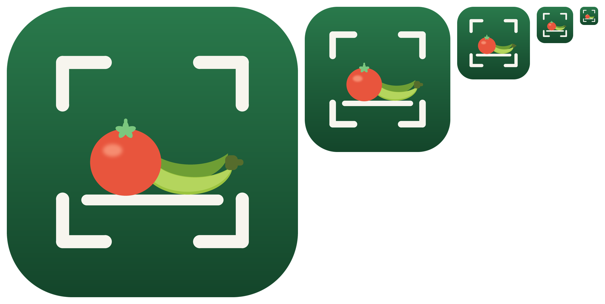

**An offline Android app that tells small market sellers what to do with their produce, from one phone photo.**

**[Technical report](https://drive.google.com/file/d/1YiQ53JR2ZipCdPhxwCKYiUp9FxvTOzZ_/view?usp=sharing)**

| | |
|---|---|
| **GitHub repository** | [github.com/Muhodari/HarvestShelfAI](https://github.com/Muhodari/HarvestShelfAI) |
| **Demo video** | [youtube.com/watch?v=JMLj4KbZb0w](https://www.youtube.com/watch?v=JMLj4KbZb0w) |
| **Technical report** | [drive.google.com/file/d/1YiQ53JR2ZipCdPhxwCKYiUp9FxvTOzZ_](https://drive.google.com/file/d/1YiQ53JR2ZipCdPhxwCKYiUp9FxvTOzZ_/view?usp=sharing) |
| **Project notebook** | [`training/notebooks/HarvestShelf_AI.ipynb`](training/notebooks/HarvestShelf_AI.ipynb) |

---

## Contents

1. [Description](#1-description)
2. [GitHub repository](#2-github-repository)
3. [Setting up the environment and the project](#3-setting-up-the-environment-and-the-project)
4. [Designs](#4-designs)
5. [Deployment plan](#5-deployment-plan)
6. [Scope alignment and feature validation](#6-scope-alignment-and-feature-validation)
7. [Architecture](#7-architecture)
8. [Technical details](#8-technical-details)
9. [Testing, validation and performance](#9-testing-validation-and-performance)
10. [Algorithms and technical problem-solving](#10-algorithms-and-technical-problem-solving)

---

## 1. Description

Small produce sellers in Rwanda lose income when tomatoes and green bananas spoil before they are sold. HarvestShelf AI lets a seller point a phone camera at one tomato or one hand of green bananas and get one clear action back:

| Action | Meaning for the seller |
|---|---|
| **Fresh** | Sell at the normal price |
| **Sell Soon** | Early signs of change: put it at the front and sell it first |
| **Discount Today** | Lower the price and sell it today |
| **Spoilage Risk** | Remove from sale; keep it away from fresh produce |
| **Uncertain** | Photo too dark or blurry, model unsure, or not a supported crop: retake the photo |

**Bananas** follow one ripeness scale for green cooking bananas: **green** is Fresh, **yellow** is Sell Soon, **spotted** is Discount Today, and **black or rotten** is Spoilage Risk. If a photo holds several items, the answer is for the **worst** one: one rotten banana in a bunch gives Spoilage Risk.

Built for sellers in **Nyabihu and Rusizi, Rwanda**. BSc Software Engineering project by **Sage Muhodari**.

| | |
|---|---|
| **Crops** | Tomato and green banana only |
| **Platform** | Android phone, Flutter app |
| **Internet** | Not needed: the model runs on the phone, and the release build has no INTERNET permission |
| **Languages** | English and Kinyarwanda |
| **Model** | EfficientNet-Lite0, TensorFlow Lite, 3.6 MB, trained on about 23,000 public photos from 6 datasets |
| **Accounts** | Stored on the phone only, with PIN login (Researcher and Seller roles) |
| **Training** | Python / TensorFlow pipeline, with a browser portal for uploading photos and retraining |

> **Important: only tomatoes and green bananas are supported.** Photos of anything else (oranges, potatoes, onions, …) are answered with **Uncertain**, never with a freshness result.

> **Warning:** the app judges **visible condition only**. It is **not a food-safety check**.

## 2. GitHub repository

**[https://github.com/Muhodari/HarvestShelfAI](https://github.com/Muhodari/HarvestShelfAI)**

```bash
git clone https://github.com/Muhodari/HarvestShelfAI.git
cd HarvestShelfAI
```

### Repository layout

```
app/          Flutter Android app (offline)
training/     Python/TensorFlow pipeline: clean → split → train → thresholds → evaluate → export
  portal/     browser portal to upload photos and train
  notebooks/  the project notebook
shared/       decision rule and quality-check cases, tested in both Dart and Python
data/         field photos + metadata.csv (not committed)
scripts/      copy_model_to_app.sh, build_release.sh
```

## 3. Setting up the environment and the project

### Requirements

| Part | Setup | Check |
|---|---|---|
| **App** | Flutter **3.32.5** (pinned in `.fvmrc`), Android SDK 36, NDK 27 | `cd app && flutter analyze && flutter test` |
| **Training** | Python **3.11**: `cd training && python3.11 -m venv .venv && .venv/bin/pip install -r requirements.txt` | `make test PY=.venv/bin/python` |
| **Training in Docker** | `docker build -t harvestshelf-train:2.15 training/`, then `docker run --rm -it -v "$PWD":/workspace -w /workspace/training harvestshelf-train:2.15` | `python -m pytest -q tests` |
| **Public dataset** | `cd training && make data-public` downloads AgriFreshNET (348 MB, CC BY 4.0) | |
| **Large dataset** | `make data-large PY=.venv/bin/python` downloads 5 more public datasets (about 3 GB after unpacking). Needs a free Kaggle account: save your API key as `~/.kaggle/kaggle.json` | |
| **Apple Silicon GPU** (optional) | `.venv/bin/pip install tensorflow-metal==1.1.0` trains about 3× faster on M-series Macs | |
| **Notebook kernel** | `.venv/bin/python -m ipykernel install --sys-prefix --name harvestshelf` | open the notebook |
| **CI** | `.github/workflows/ci.yml` runs the app tests, the Python tests and a smoke test on every push | |

### Run the app

```bash
cd app
flutter test                                                   # unit, widget and full-app-flow tests
flutter test integration_test/parity_test.dart -d <device>     # phone vs Python on real test photos
flutter run                                                    # on a connected Android phone
../scripts/build_release.sh                                    # release APKs; fails if extra permissions sneak in
```

### Retrain from the command line

```bash
cd training
make large PY=.venv/bin/python      # all 6 public datasets + mixed scenes → train → test → install in the app (about 1 hour on an M3 GPU)
make public PY=.venv/bin/python     # AgriFreshNET only: train all candidate models and compare them
```

### Training portal (optional)

```bash
cd training && .venv/bin/python -m portal      # then open http://127.0.0.1:8765
```

See [Training portal](#training-portal-add-photos-and-retrain) below for what each tab does.

## 4. Designs

### Screen design

The screens were planned as low-fidelity wireframes in the approved proposal (Figure 10) and then built directly in Flutter. The finished screens are shown in [Screenshots of the app](#screenshots-of-the-app). Each result screen follows the same layout so a seller learns it once: photo, action with confidence, what to do next.

### Circuit diagram

HarvestShelf AI is **software only**: it runs on an ordinary Android phone and uses no extra hardware, sensors or circuits, so there is no circuit diagram. The system architecture is shown instead. The phone does all the work offline; the laptop is only used to train a new model and copy it into the app.

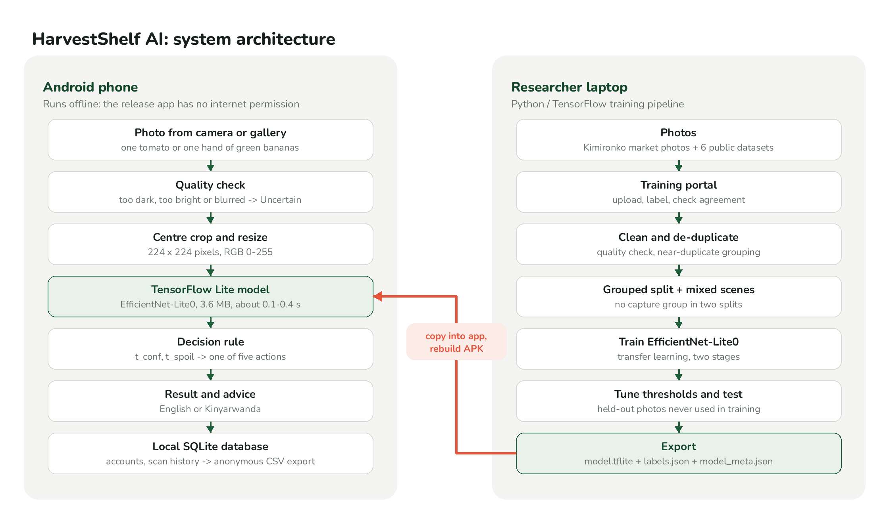

More diagrams are in [Architecture](#7-architecture).

### Screenshots of the app

Taken on a Pixel 8 Android emulator with the current model (30 Oct 2026). Photo credits: [`docs/screenshots/CREDITS.md`](docs/screenshots/CREDITS.md).

| Welcome | Home (Scan tab) | History |
|:-:|:-:|:-:|
| 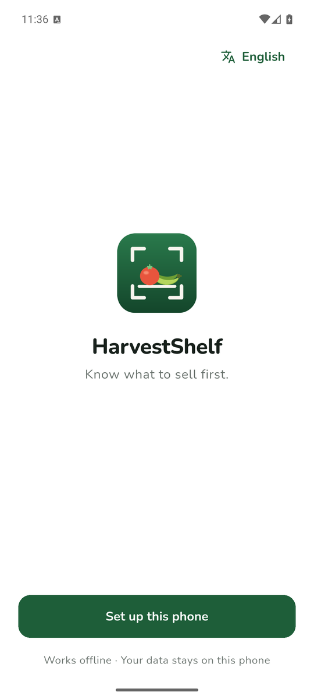 | 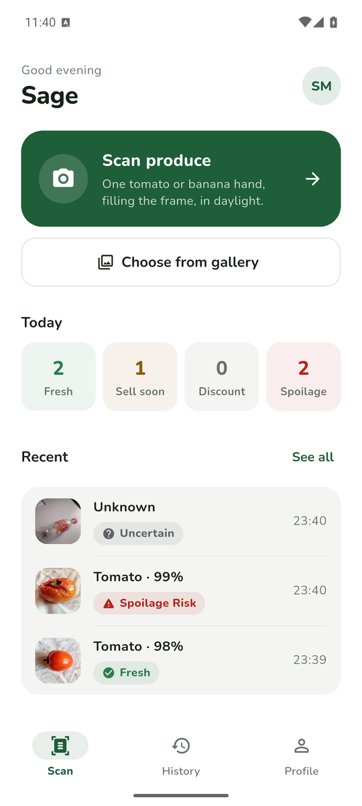 | 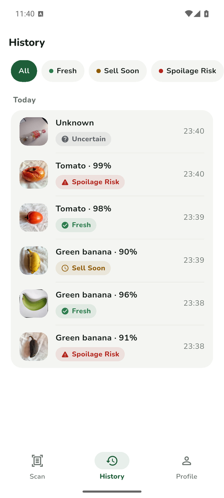 |

Every result has the same layout: the photo, the action with its confidence, and what to do next.

| Green banana: Fresh | Yellow banana: Sell Soon | Rotten banana: Spoilage Risk |
|:-:|:-:|:-:|
| 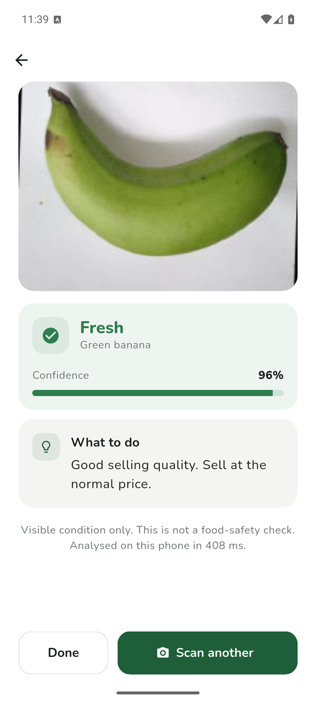 | 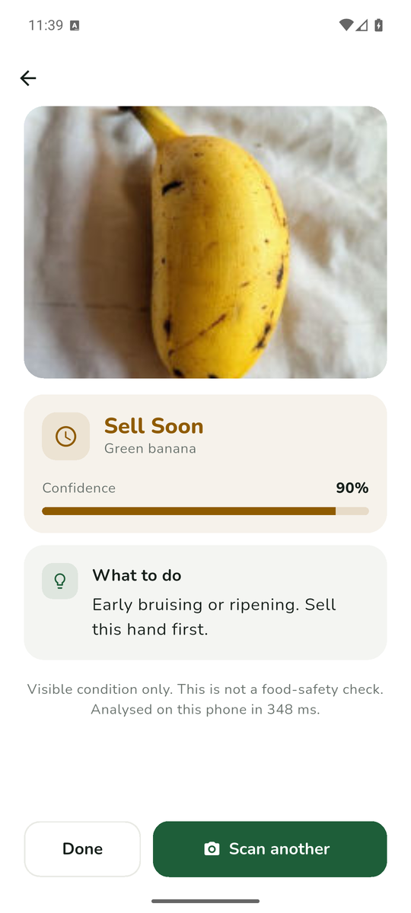 | 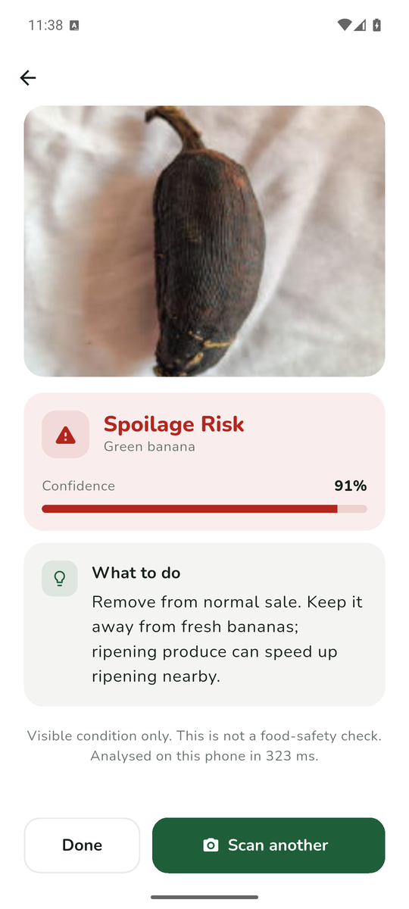 |

| Fresh tomato | Rotten tomato: Spoilage Risk | Bottle: No vegetable or fruit found |
|:-:|:-:|:-:|
| 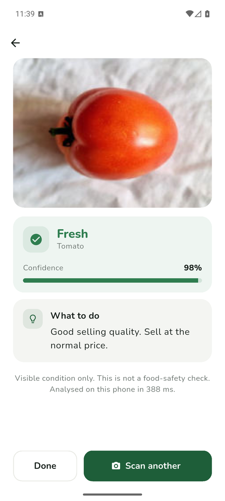 | 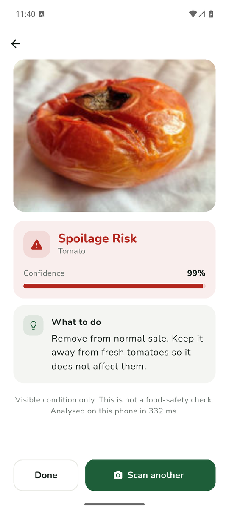 | 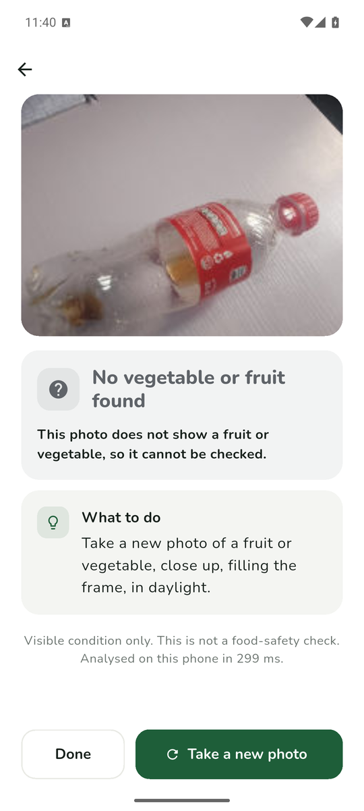 |

## 5. Deployment plan

The app is deployed **directly onto phones as an APK**, not through the Play Store, because it is a research tool used in a supervised field study and needs no internet.

| Step | What happens | Tool |
|---|---|---|
| **1. Test** | Every push runs the app tests, the Python tests and a training smoke test. | GitHub Actions ([`.github/workflows/ci.yml`](.github/workflows/ci.yml)) |
| **2. Train the model** | Collect labelled market photos with the training portal, retrain, and check the results against the targets (macro-F1 ≥ 0.80, spoilage recall ≥ 0.85, model < 10 MB). | `training/` pipeline, training portal |
| **3. Install the model** | Copy the exported model and its thresholds into the app. No app code changes are needed. | **Install in app** in the portal, or `scripts/copy_model_to_app.sh` |
| **4. Build the release** | Build one APK per CPU type (each under 50 MB). The build fails if the app asks for internet, phone or storage permissions. | `scripts/build_release.sh` |
| **5. Install on phones** | Copy the APK to each study phone (USB or `adb install`) and install it. The first account created on a phone is the Researcher. | `adb install app-arm64-v8a-release.apk` |
| **6. Field study** | Sellers in Nyabihu and Rusizi markets use the app. Everything stays on the phone. | the app |
| **7. Collect results** | The researcher exports the scan log as CSV (anonymous user IDs, inference time per scan) and compares it with the targets. | Profile → Export |
| **8. Update** | New field photos go back into the portal, the model is retrained, and a new APK is installed over the old one. Existing scans and accounts are kept. | steps 2–5 again |

**Before the field study:** the Kinyarwanda text must be reviewed by a native speaker, and the model should be fine-tuned on Rwandan market photos collected with the training portal (the current model has seen public photos only).

## 6. Scope alignment and feature validation

This section compares the finished project with the approved proposal. Requirement IDs (FR = functional, NFR = non-functional) are the ones cited in code comments next to the code that implements them.

### Feature status

| Planned feature | Intended purpose | Current status | Evidence |
|---|---|---|---|
| **FR1** Take or choose a photo | Let a seller check produce with the phone they already have | **Completed** | Camera and gallery buttons on the Scan tab ([`scan_screen.dart`](app/lib/screens/scan_screen.dart)); screenshot [`scan_tab.png`](docs/screenshots/scan_tab.png) |
| **FR2** Photo quality check | Reject dark, overexposed or blurred photos before they give a wrong answer | **Completed** | [`image_quality_service.dart`](app/lib/services/image_quality_service.dart); same results in Dart and Python ([`shared/quality_cases.json`](shared/quality_cases.json), `image_quality_test.dart`) |
| **FR3** On-device AI model | Classify the produce on the phone, with no internet | **Completed** | [`classifier_service.dart`](app/lib/services/classifier_service.dart); 3.6 MB TFLite model in [`app/assets/model/`](app/assets/model/); phone and Python give the same answer on 24 of 24 test photos (`integration_test/parity_test.dart`) |
| **FR4** One action with confidence and advice | Tell the seller what to do: Fresh, Sell Soon, Discount Today, Spoilage Risk or Uncertain | **Completed** | [`decision_mapper.dart`](app/lib/services/decision_mapper.dart), [`result_screen.dart`](app/lib/screens/result_screen.dart), [`guidance_rules.json`](app/assets/guidance_rules.json); screenshots in [Designs](#screenshots-of-the-app) |
| **FR5** Scan history | Let sellers look back at earlier results | **Completed** | [`history_screen.dart`](app/lib/screens/history_screen.dart), [`repositories.dart`](app/lib/data/repositories.dart); each seller sees only their own scans (`data_test.dart`) |
| **FR6** Anonymous test-log export | Give the researcher data to measure the app in the field study | **Completed** | [`export_service.dart`](app/lib/services/export_service.dart): CSV with an anonymous user ID, no names or photos (`data_test.dart`) |
| **Model accuracy** (Objective 3): macro-F1 ≥ 0.80, Spoilage Risk recall ≥ 0.85, model < 10 MB | Make sure the advice is reliable enough to act on | **Partial**: met on public test data (F1 0.92, recall 0.96, 3.6 MB); not yet measured in Rwandan markets | [Current status](#current-status); `training/sandbox/large/work/experiments/large_efficientnet_lite0/test_metrics.json` |
| **Model comparison** (Section 3.4.5) | Choose the best model for low-cost phones in a fair test | **Partial**: all six models compared on AgriFreshNET; only EfficientNet-Lite0 retrained on the large dataset | [Project notebook](training/notebooks/HarvestShelf_AI.ipynb); [`src/compare.py`](training/src/compare.py) |
| **Rwandan field photo dataset** | Train and test on the produce, light and markets sellers really have | **Partial**: photos collected at **Kimironko market (Kigali)**; not yet labelled, uploaded or used to train or test the model | Upload, labelling and retraining tool ready: [training portal](#training-portal-add-photos-and-retrain). The photos are not in this repository (`data/` is kept out of git) |
| **Labeller agreement check** (Cohen's kappa ≥ 0.70) | Make sure field labels are consistent before training on them | **Not implemented**: needs a second person to label the Kimironko photos | The check is built into [`clean.py`](training/src/clean.py) (`labeling.min_kappa` in [`config.yaml`](training/config.yaml)); the portal's Photos tab takes a second label |
| **Field study** in Nyabihu and Rusizi | Measure the app with real sellers | **Not implemented** | Planned in the [Deployment plan](#5-deployment-plan); the export it needs (FR6) is ready |
| **Screen designs** | Design the screens before building them | **Completed (changed)**: low-fidelity wireframes from the proposal used instead of Figma mockups | [Screen design](#screen-design); built screens in [screenshots](#screenshots-of-the-app) |
| **NFR1** Works offline | Markets often have poor or costly internet | **Completed** | No INTERNET permission in [`AndroidManifest.xml`](app/android/app/src/main/AndroidManifest.xml); [`build_release.sh`](scripts/build_release.sh) fails the build if one appears; release APK checked on 30 Oct 2026 |
| **NFR5** Privacy | Keep sellers' photos and data on their own phone | **Completed** | No phone or storage permissions; data in local SQLite; PINs hashed with PBKDF2 ([`pin_hasher.dart`](app/lib/services/auth/pin_hasher.dart)) |
| **NFR6** Explainable, cautious decisions | Never give a confident answer the model is unsure of | **Completed** | Decision rule with tuned thresholds ([How a scan works](#how-a-scan-works)); Python and Dart rules tested on the same cases ([`shared/decision_cases.json`](shared/decision_cases.json)) |
| **Fast scans** (< 1 s on a 3–4 GB phone) | Keep the queue moving at the stall | **Partial**: median 124 ms on a Pixel 8 emulator; not yet timed on a real low-cost phone | `PARITY SUMMARY median_ms=124` from `parity_test.dart`; the field export records `inference_ms` per scan |
| **Small app** (< 50 MB) | Fit on low-storage phones and share easily | **Completed**: 14–15 MB per APK | `flutter build apk --release --split-per-abi` (30 Oct 2026) |
| **Release-ready APK** | Install a trustworthy, updatable build on study phones | **Partial**: the release build is still signed with the debug key | `signingConfig = signingConfigs.getByName("debug")` in [`build.gradle.kts`](app/android/app/build.gradle.kts) |
| **English and Kinyarwanda** | Sellers can use the app in their own language | **Partial**: both languages built in; Kinyarwanda not yet checked by a native speaker | [`app_text.dart`](app/lib/l10n/app_text.dart); language switch on the Welcome screen |

### Scope changes and why

| Change | Type | Reason |
|---|---|---|
| First field photos from **Kimironko market (Kigali)** | Change | Photos were collected in Kimironko rather than in Nyabihu or Rusizi. The field study is still planned in Nyabihu and Rusizi. |
| **EfficientNetV2-B0** instead of MobileNetV2 as a candidate model | Change | A newer model of similar size gives a fairer modern comparison ([`models.py`](training/src/models.py)). |
| **Local accounts** with Researcher and Seller roles | Added | Several sellers can share one study phone and each sees only their own history; still offline. |
| **Training portal** (browser tool) | Added | Lets the research team upload and label field photos and retrain without the command line. |
| **"Not produce" rejection and mixed-photo handling** | Added | Testing showed bottles and multi-item photos got wrong answers. The model now learns from non-produce images and multi-item scenes, and shows "No vegetable or fruit found" for non-produce. |
| **Green-banana ripeness scale** | Clarified | Yellow bananas are already ripening for a seller of green cooking bananas, so yellow is Sell Soon, not Fresh. |
| **iOS build** | Added | For testing on the iOS simulator. Android remains the target platform. |
| **Wireframes instead of Figma mockups** | Change | The proposal's low-fidelity wireframes were detailed enough to build from; time went into testing the real screens on several sizes instead (see [Testing](#9-testing-validation-and-performance)). |
| **Tomato Discount Today** answers | Limited | No public dataset has examples of it. It must come from field photos. |

## 7. Architecture

Both halves of the project are split into small modules, each with one job. Dependencies point inwards (screens → services → data → models), and every service gets what it needs through its constructor, so it can be tested on its own.

**System overview:** the offline phone app and the training side are shown in the [system architecture diagram](#circuit-diagram).

**Inside the app:** four layers, with one composition root that creates and connects every service.

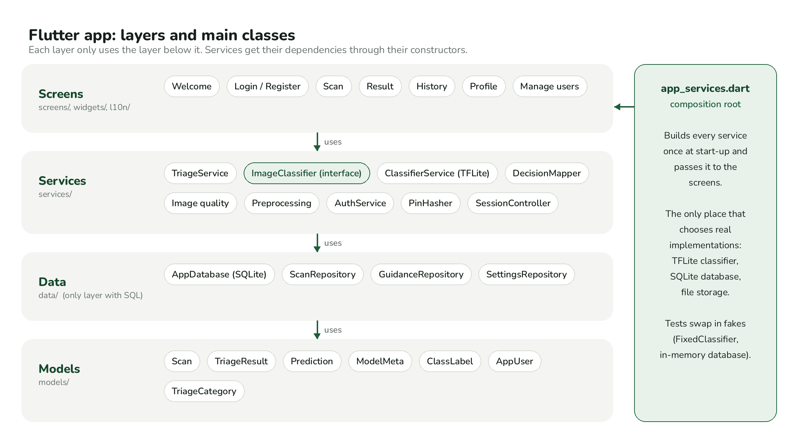

**Object-oriented design in the app:**

| Principle | Where it is applied |
|---|---|
| **Abstraction / interfaces** | `TriageService` depends on the `ImageClassifier` interface, not on TensorFlow Lite. The app plugs in `ClassifierService`; tests plug in `FixedClassifier` ([`image_classifier.dart`](app/lib/services/image_classifier.dart)). |
| **Single responsibility** | One unit per job: `QualityReport` (FR2), `prepareImage` (runs in a background isolate), `ClassifierService` (FR3), `DecisionMapper` (FR4), `TriageService` (orchestrates the scan), `ScanRepository` (FR5), `scansToCsv` (FR6), `PinHasher`, `AuthService`, `SessionController`. Pure functions are used where no state is needed. |
| **Encapsulation** | Only the repositories in [`repositories.dart`](app/lib/data/repositories.dart) touch SQL; screens never see the database. |
| **Dependency injection** | [`app_services.dart`](app/lib/app_services.dart) is the one place that builds and wires every service; each class receives its collaborators through its constructor. |
| **Immutable value objects** | `Scan`, `TriageResult`, `ModelMeta` and `AppUser` are `const` data classes with `fromMap` / `fromJson` factories. |
| **Data-driven behaviour** | Thresholds, labels and advice text are loaded from `model_meta.json` and `guidance_rules.json`, so a new model or new advice needs no code change. |

**Training pipeline:** each step is its own module and can be re-run on its own.

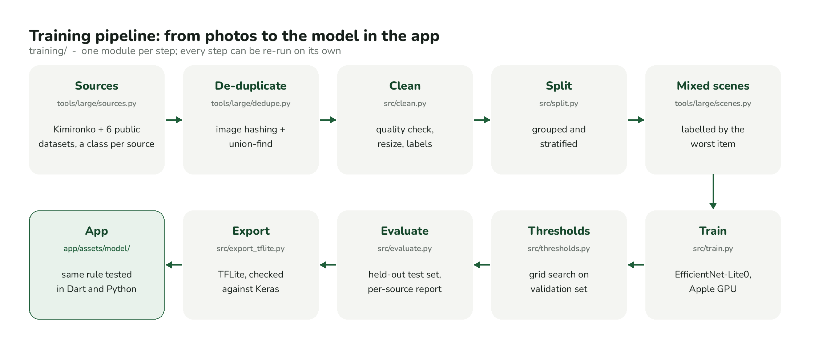

**Folders:**

```
app/lib/
  models/      plain data classes (Scan, TriageResult, ModelMeta, AppUser)
  data/        SQLite database and repositories: the only code that writes SQL
  services/    the scan pipeline: preprocessing, quality check, classifier, decision rule, triage; auth/ for accounts
  screens/     one file per screen; no business logic
  widgets/     reusable UI pieces, grouped by purpose (scan, layout, forms, users, brand)
  l10n/        all user-facing text, English and Kinyarwanda side by side
  core/        theme, asset paths, time formats
  app_services.dart   composition root: builds every service once at start-up

training/
  src/         one module per pipeline step: clean → split → train → thresholds → evaluate → export
  tools/large/ the large-dataset experiment: sources.py, dedupe.py, scenes.py
  portal/      the browser training portal (Flask)
  tests/       50 unit tests
```

## 8. Technical details

### Current status

*Last updated: 30 Oct 2026*

The app ships with a model trained on **six public datasets**: 23,024 photos after cleaning, plus 5,400 generated mixed scenes. **Field photos have been collected at Kimironko market (Kigali) but are not labelled or used in training yet.**

| Dataset | Licence | What it adds |
|---|---|---|
| [AgriFreshNET](https://doi.org/10.17632/42m5tb7yv9.1) | CC BY 4.0 | tomatoes and bananas at three freshness stages; other crops as "not supported" |
| [Banana Ripeness Classification](https://www.kaggle.com/datasets/shahriar26s/banana-ripeness-classification-dataset) | see Kaggle page | **green** bananas, and the only Discount Today examples (overripe) |
| [Fresh and Stale Fruits and Vegetables](https://www.kaggle.com/datasets/raghavrpotdar/fresh-and-stale-images-of-fruits-and-vegetables) | see Kaggle page | fresh/stale tomatoes, yellow and stale bananas, other produce |
| [Fruit and Vegetable Disease (Healthy vs Rotten)](https://www.kaggle.com/datasets/muhammad0subhan/fruit-and-vegetable-disease-healthy-vs-rotten) | CC0 | healthy/rotten tomatoes, rotten bananas, 9 other crops |
| [Garbage Classification](https://www.kaggle.com/datasets/asdasdasasdas/garbage-classification) | see Kaggle page | bottles, cans, glass, paper: things that are not produce |
| [Imagenette](https://github.com/fastai/imagenette) | ImageNet subset, research use | everyday objects and scenes |

How the data is prepared ([`tools/large_experiment.py`](training/tools/large_experiment.py)):

- **Duplicates are removed or kept together.** Exact copies are dropped. Near-identical photos (resized or re-encoded copies, video frames) are found with image hashing and kept in the same group, so a photo and its copy never end up on both sides of the train/test split.
- **Mixed scenes are generated.** Collages of 2–6 items on varied backgrounds are labelled by the worst item. Test scenes are built only from test photos.
- **Things that are not produce are in the training data,** so bottles, cans and other objects are answered with Uncertain.
- **Thresholds are chosen on the validation set** with an extra rule: at least 95% of "not supported" photos must be shown as Uncertain.

Test results on held-out photos (4,307 photos and scenes the model never saw):

| | Macro-F1 | Spoilage recall | Not-supported rejected |
|---|:-:|:-:|:-:|
| **Single photos** (3,607) | **0.957** | **0.973** | 0.930 |
| Mixed scenes (700) | 0.718 | 0.868 | 0.960 |
| **All test images** | **0.923** | **0.956** | 0.935 |
| Previous model (AgriFreshNET only, its own test set) | 0.822 | 0.957 | n/a |
| ***Target*** | ***≥ 0.80*** | ***≥ 0.85*** | |

Per action on the whole test set: Fresh F1 0.94, Sell Soon 0.90, Discount Today 0.88, Spoilage Risk 0.96. Bottles, cans and everyday objects in the test set were **all** rejected. On the phone (Pixel 8 emulator) the app gives the same answer as Python on all 24 check photos; the median scan takes 124 ms. Model size: 3.6 MB.

**Known limits**

- **Tomato Sell Soon** has only 287 photos (all from AgriFreshNET), and there are **no tomato Discount Today photos** in any public dataset. These are the weakest tomato answers.
- **Mixed scenes** are harder than single photos (F1 0.72). The app still asks for one item per photo.
- **A photo of several plastic bottles** can still be called Spoilage Risk; a single bottle is rejected.
- **The Fresh and Stale test score (0.99) is probably too high.** That dataset is built from video frames, so some near-identical frames may sit in both training and test.
- **The model has not been trained or tested on Rwandan market photos yet.** The Kimironko photos still need labelling; accuracy in Nyabihu and Rusizi must be measured in the field study.

**Next step:** label the Kimironko photos, upload them with the [training portal](#training-portal-add-photos-and-retrain), then fine-tune and re-test on them.

### Project notebook

[**`training/notebooks/HarvestShelf_AI.ipynb`**](training/notebooks/HarvestShelf_AI.ipynb) covers the whole project in one place:

- the problem and the system design
- the data and how it is cleaned and split
- training and the comparison of all candidate models
- results: metrics, confusion matrices, training curves and example predictions
- a live run of the model that is in the app
- on-device results, limitations, and how to reproduce everything

It is saved with its outputs, so you can **read it without running anything**. It documents the first model (AgriFreshNET only) and the comparison of model types; the current model's results are in [Current status](#current-status) and in `training/sandbox/large/work/experiments/large_efficientnet_lite0/`. To run it again:

```bash
cd training && .venv/bin/jupyter lab notebooks/HarvestShelf_AI.ipynb   # kernel: "HarvestShelf (training/.venv)"
```

### Training portal: add photos and retrain

A local web page for adding labelled photos and training new models, with no command line needed.

```bash
cd training && .venv/bin/python -m portal      # or: make portal PY=.venv/bin/python
```

Then open **http://127.0.0.1:8765**. The portal runs on your computer only.

| Tab | What you can do |
|---|---|
| **Upload** | Drop in photos and choose the crop (tomato, green banana or other), the label, market, date and batch. Files are saved to `data/raw/<date>_<market>/`, with one row each in `data/metadata.csv`. |
| **Photos** | See how many photos each label has against the 300-per-label target. Add a second person's label for the agreement check, filter, and delete photos. |
| **Train** | Pick a model and the number of epochs, then start a run and follow the live log. Each run shows its test results. **Install in app** copies the model into `app/assets/model`; rebuild the app to use it. |

> **Tip:** keep **Include public photos** ticked until you have photos from many separate batches. Training needs whole batches it can set aside for testing.
> Upload *Other produce* photos too, labelled **Unusable**. They teach the model to answer Uncertain for crops it does not support.

Portal runs are saved in `training/sandbox/portal/` (not committed).

### How a scan works

```
photo (camera or gallery, ≤ 1280 px)
  → quality check: brightness 40–235, sharpness ≥ 80      fail → Uncertain (too dark / too bright / blurry)
  → centre square crop, resize to 224×224, RGB 0–255
  → TFLite model on the phone → 9 probabilities
       (tomato × 4 actions, banana × 4 actions, unusable)
  → decision rule:
       top class = unusable                    → Uncertain   (not a tomato/green banana, or unusable photo)
       P(spoilage of that crop) ≥ t_spoil      → Spoilage Risk
       top probability < t_conf                → Uncertain
       otherwise                               → top action
  → advice text from the guidance rules → scan saved on the phone
```

`t_conf` and `t_spoil` are tuned on the validation set (`src.thresholds`); `t_spoil` is the main lever for reaching spoilage recall ≥ 0.85. Both values ship in `model_meta.json`, so retraining never needs app code changes.

### App features

#### Languages

English and **Kinyarwanda**. Switch on the Welcome screen or in Profile → Language; the choice is remembered on the phone. All text is in [`app/lib/l10n/app_text.dart`](app/lib/l10n/app_text.dart), with both languages side by side.

> **Note:** the Kinyarwanda text must be reviewed by a native speaker before the field study. Android's own system buttons stay in English, because Flutter has no built-in Kinyarwanda translations for them.

#### Accounts (offline)

Accounts are stored only on the phone (SQLite), so the app still needs no internet.

- **Register and log in** with a name, a username and a 4–6 digit PIN. Obvious PINs (`1234`, `0000`, …) are refused.
- **PINs are never stored in plain text.** They are hashed with PBKDF2-HMAC-SHA256 (60,000 iterations, random salt).
- **The first account on a phone becomes the Researcher.** Later sign-ups are Sellers.
- **Researchers** can add users, change roles, reset PINs, delete users (with their scans) and export the test log. The last researcher cannot be removed.
- **Sellers** see only their own scan history.
- **Five wrong PINs** lock the account for 30 seconds. A wrong username and a wrong PIN give the same error.
- **Sessions survive app restarts.** Log out from Profile.
- **The exported CSV** has an anonymous `user_id` number, with no names or usernames.
- **Upgrading the database from v1 to v2** keeps existing scans. They have no owner, so they appear only in the export.

### Targets and where they are measured

| Project target | Where it is measured |
|---|---|
| Action macro-F1 ≥ 0.80, spoilage recall ≥ 0.85 | `src.evaluate --split test` → `test_metrics.json` |
| Inference < 1 s on a 3–4 GB phone | `inference_ms` in the app's exported test log |
| App < 50 MB, model < 10 MB | `build_release.sh`, `export_report.json` |

Requirements FR1–FR6, NFR1, NFR5 and NFR6 are cited in comments next to the code that implements them.

### Logo and font

The icon shows a tomato and a hand of green cooking bananas on a market shelf, inside camera scan corners. After replacing `app/assets/brand/icon.png`, regenerate the launcher icons with `cd app && dart run flutter_launcher_icons`.

The font is **Nunito** (SIL Open Font License, [`app/assets/fonts/OFL.txt`](app/assets/fonts/OFL.txt)), bundled with the app.

## 9. Testing, validation and performance

All **125 automated tests pass** (75 Flutter + 50 Python), and `flutter analyze` and `ruff check` report no issues (31 Oct 2026). CI runs all of them on every push.

### Testing strategies

| Strategy | What it proves | Where |
|---|---|---|
| **Unit tests** | Each rule and service works alone: decision rule, quality check, resize, PIN hashing (checked against published PBKDF2 test vectors), repositories | `app/test/*_test.dart`, `training/tests/` |
| **Widget tests** | Each result type renders the right action, confidence, advice and buttons | [`widget_test.dart`](app/test/widget_test.dart) |
| **Full app-flow tests** | First run → register researcher → home → history → profile → log out → log in; language switch is remembered; start-up failure shows an error screen | [`app_navigation_test.dart`](app/test/app_navigation_test.dart) |
| **Database migration tests** | Upgrading v1 → v2 → v3 keeps existing scans and accounts | [`data_test.dart`](app/test/data_test.dart) |
| **Cross-language tests** | Dart and Python give identical decisions and quality verdicts on the same cases, so the evaluation measures what the phone actually does | [`shared/decision_cases.json`](shared/decision_cases.json), [`shared/quality_cases.json`](shared/quality_cases.json) |
| **On-device parity test** | The phone's TFLite output matches Python on real test photos | [`integration_test/parity_test.dart`](app/integration_test/parity_test.dart) |
| **End-to-end pipeline test** | clean → split → train → thresholds → export runs on generated images | `training/tools/smoke_test.py` (CI) |
| **Model evaluation** | Accuracy on held-out photos never used for training or threshold tuning | `src.evaluate --split test` |

### Edge cases covered

| Input or situation | Expected behaviour | Tested in |
|---|---|---|
| Black, white or flat grey photo | Uncertain: too dark / too bright / blurred, model not run | `image_quality_test.dart`, `data_test.dart` |
| Confidence exactly at the threshold | Accepted, not Uncertain | `decision_mapper_test.dart` |
| Wrong number of model outputs | Clear error, no silent wrong answer | `decision_mapper_test.dart` |
| Spoilage probability high but not the top class | Spoilage Risk wins, with its reason shown | `decision_mapper_test.dart`, `widget_test.dart` |
| A bottle or other non-produce photo | "No vegetable or fruit found" | `widget_test.dart` |
| Obvious PINs (`1234`, `0000`), duplicate usernames in any case | Refused | `auth_test.dart` |
| Wrong PIN vs unknown user | Same error, so usernames cannot be guessed | `auth_test.dart` |
| Five wrong PINs | 30-second lockout; a researcher's PIN reset clears it | `auth_test.dart` |
| Removing the last researcher | Refused | `auth_test.dart` |
| An email typed as a username | The mistake is explained | `app_navigation_test.dart` |
| Unknown crop in the advice rules | Falls back to the general advice | `data_test.dart` |

### Device and environment compatibility

| Environment | What was checked |
|---|---|
| Small phone, 360 × 640, text 1.0 | Every screen fits without overflow (`layout_test.dart`) |
| Phone 412 × 915, text 1.6 and 2.0 (largest accessibility size) | Every screen fits |
| Landscape 915 × 412, text 1.3 | Every screen and the result screen fit |
| Screen reader | Labels exist on key controls |
| Android: Pixel 8 emulator | Full app, camera/gallery flow, parity test, screenshots |
| iOS simulator | App builds and runs (secondary platform) |
| Ubuntu (GitHub Actions) and macOS (Apple Silicon) | All Flutter and Python tests pass on both |
| English and Kinyarwanda | Language switch changes all text and is remembered |

### Performance

| Measure | Result | Target |
|---|---|---|
| Model inference on the phone (Pixel 8 emulator, median of the parity run) | **124 ms** | < 1 s |
| Whole scan shown to the user (result screens) | 299–408 ms | < 1 s |
| Model size | **3.6 MB** | < 10 MB |
| Release APK size | **14–15 MB** per CPU type | < 50 MB |
| PIN hashing (PBKDF2, 60,000 iterations) | 132 ms | slow enough to resist guessing, fast enough to log in |
| Model candidates on a laptop CPU (TFLite) | Lite0 8.6 ms · MobileNetV3-Small 2.4 ms · EfficientNetV2-B0 20.4 ms · ResNet-50 36.6 ms | Lite0 chosen for accuracy at small size |

The field export records `inference_ms` for every scan, so timing on a real 3–4 GB phone will come from the field study.

## 10. Algorithms and technical problem-solving

| Problem | Solution | Code |
|---|---|---|
| **A wrong "Fresh" on spoiling produce costs a seller most** | Ordered decision rule: unsupported → **spoilage check first** → low confidence → top class. A spoilage probability ≥ `t_spoil` overrides a higher Fresh score. | [`decision_mapper.dart`](app/lib/services/decision_mapper.dart), [`decision.py`](training/src/decision.py) |
| **Choosing the two thresholds** | Grid search over `t_conf` × `t_spoil` on the validation set: maximise macro-F1 subject to spoilage recall ≥ 0.85, Uncertain rate ≤ 15 % and ≥ 95 % of non-produce rejected. Never tuned on the test set. | [`thresholds.py`](training/src/thresholds.py) |
| **The blur check rejected 43 % of sharp tomato photos** | A smooth fruit on plain cloth has few edges overall. Sharpness is now the Laplacian variance of the **sharpest tile in a 4 × 4 grid**, implemented identically in Dart and Python. | [`image_quality_service.dart`](app/lib/services/image_quality_service.dart), [`quality.py`](training/src/quality.py) |
| **Copies of a photo leaking into the test set inflated the score** | Near-duplicate detection with two difference hashes (64- and 256-bit). Candidates are found by **banding** (pigeonhole: within 5 bits means one of four 16-bit bands matches exactly), avoiding n² comparisons; matches are merged with **union-find**, with a size cap. The split is then grouped so a group never crosses train/test. | [`dedupe.py`](training/tools/large/dedupe.py), [`split.py`](training/src/split.py) |
| **Photos with several items** | Generated collages of 2–6 items on varied backgrounds, labelled by the **worst** item; test scenes use only test photos. | [`scenes.py`](training/tools/large/scenes.py) |
| **Missed spoilage is worse than a false alarm** | Extra class weight (×1.5) on spoilage classes and label smoothing (0.1) for better-calibrated confidence. | [`train.py`](training/src/train.py), [`config.yaml`](training/config.yaml) |
| **Phone and Python must see the same pixels** | A Dart box-filter resize written to match Pillow's BOX filter exactly, tested against Pillow output. | [`resize.dart`](app/lib/services/resize.dart), `resize_test.dart` |
| **Keeping the UI smooth** | Decoding, quality check and resizing run on a background isolate (`compute`). | [`preprocessing_service.dart`](app/lib/services/preprocessing_service.dart) |
| **PINs on a shared phone** | PBKDF2-HMAC-SHA256 with a random salt, the same error for a wrong username or PIN, and a 30-second lockout after five failures. | [`pin_hasher.dart`](app/lib/services/auth/pin_hasher.dart), [`auth_service.dart`](app/lib/services/auth/auth_service.dart) |
